  

  <a href="#about">About</a> &nbsp;|&nbsp;
  <a href="#featured-projects">Projects</a> &nbsp;|&nbsp;
  <a href="#open-source-contributions">Open source</a> &nbsp;|&nbsp;
  <a href="#tech-stack">Tech stack</a> &nbsp;|&nbsp;
  <a href="#github-activity">Activity</a>

## About

I'm a developer who builds AI agents, payment systems and the evaluations that test them. I focus on software where a wrong action costs real money, and on making that software show what it did and why.

I maintain about 60 public repositories. Many began as hackathon or challenge entries that I kept developing after the deadline. I also contribute upstream to Meshery, Hermes Agent and Kestra.

| | |
| :-- | :-- |
| **Focus** | AI agent security, resilient payments, model evaluation |
| **Main languages** | TypeScript, Python, Go, Rust |
| **Open source** | 8 merged pull requests across Meshery, Hermes Agent and Kestra |
| **Latest work** | OrderBook-DST, Lineage, WIF Tape, Sangam, Enfeoff |

 

## Featured projects

| Project | Area | Description |
| :-- | :-- | :-- |
| [**Lineage**](https://github.com/Shikhyy/lineage) ([demo](https://lineage-beryl.vercel.app)) | Agent security | A payment agent that cannot be phished. Every payment detail carries its provenance, and 0 of 12 simulated attacks succeed. |
| [**Sentinyx**](https://github.com/Shikhyy/sentinyx) ([demo](https://sentinyx.vercel.app)) | Agent security | Finds instructions hidden in onchain text that agents read, and stops the agent from obeying them. |
| [**Enfeoff**](https://github.com/Shikhyy/enfeoff) ([demo](https://enfeoff.vercel.app)) | Agent security | On-chain delegation for AI agents on Solana. A sub-agent never receives more authority than its parent holds. |
| [**Precedent**](https://github.com/Shikhyy/precedent) | Agent security | Solidity security advice treated like case law: every claim is dated and newer rulings supersede older ones. |
| [**ResilientPay**](https://github.com/Shikhyy/ResilientPay) | Payments | Research prototype for payments that survive poor connectivity: offline authorization, store-and-forward, later reconciliation. |
| [**WIF Tape**](https://github.com/Shikhyy/wiftape) ([demo](https://wiftape.vercel.app)) | Payments | A round-based stock-token prediction game on Robinhood Chain, settled by Chainlink. |
| [**OrderBook-DST**](https://github.com/Shikhyy/orderbook-dst) | Evaluation | An eval for exchange-core code that must stay correct across hundreds of events. 17 tasks and 329 real model trials. |
| [**RippleCI**](https://github.com/Shikhyy/RippleCI) ([demo](https://ripple-ci.vercel.app)) | Evaluation | Release intelligence that traces a change's blast radius through a code graph and selects which tests to run. |
| [**Cairnquill**](https://github.com/Shikhyy/cairnquill) ([demo](https://cairnquill.vercel.app)) | Evaluation | An AML report copilot on Snowflake. An LLM drafts claims and a SQL verifier blocks any number it cannot prove. |
| [**Sangam**](https://github.com/Shikhyy/sangam) ([demo](https://sangam-voice.vercel.app)) | Voice | A voice agent that talks like you, matching how you mix Hindi and English. |
| [**Scythe 3D**](https://github.com/Shikhyy/scythe) | Games | A browser multiplayer version of the board game Scythe for one to five players. |

## Open source contributions

<table>
  <tr>
    <td align="center" width="33%">
       
      <b>Meshery</b> 
      4 merged, 1 open
    </td>
    <td align="center" width="33%">
       
      <b>Hermes Agent</b> 
      1 merged, 3 open
    </td>
    <td align="center" width="33%">
       
      <b>Kestra</b> 
      3 merged
    </td>
  </tr>
</table>

View the pull requests

 

**Meshery**
- [Make provider package installation robust: bounded download, atomic extraction, GitHub tarballs](https://github.com/meshery/meshery/pull/23574) (open)
- [Preserve the provider status when deleting a performance profile fails](https://github.com/meshery/meshery/pull/23549) (merged)
- [Fix typos in user-facing error and log messages](https://github.com/meshery/meshery/pull/23546) (merged)
- [Return 404 when deleting a performance profile that does not exist](https://github.com/meshery/meshery/pull/23544) (merged)

**Hermes Agent**
- [Add chronos speculative reasoning plugin to the catalog](https://github.com/NousResearch/hermes-agent/pull/150020) (merged)
- [Recover desktop sessions on canonical not_found](https://github.com/NousResearch/hermes-agent/pull/152829) (open)
- [Reject unverifiable Telegram media before an unbounded download](https://github.com/NousResearch/hermes-agent/pull/152811) (open)
- [Defer psutil import and guard conftest process reap](https://github.com/NousResearch/hermes-agent/pull/150315) (open)

**Kestra**
- [GoodData plugin: workspaces, dataSources, executions and layouts tasks, plus a trigger](https://github.com/kestra-io/plugin-gooddata/pull/5) (merged)
- [Automated data quality validator with DuckDB](https://github.com/kestra-io/blueprints/pull/1606) (merged)
- [Skip blueprint indexing when the doc-indexing webhook is unset](https://github.com/kestra-io/blueprints/pull/4619) (merged)

## Tech stack

**Built for and with**

## GitHub activity

  

Contribution invaders

 

 

  Graphics are generated from my GitHub contribution calendar by <code>scripts/generate.py</code>. All repositories are on the <a href="https://github.com/Shikhyy?tab=repositories">repositories tab</a>.

