<picture>
  <source media="(prefers-color-scheme: dark)" srcset="assets/hero-dark.svg">
  
</picture>

  <a href="#about">About</a> &nbsp;|&nbsp;
  <a href="#education-and-experience">Experience</a> &nbsp;|&nbsp;
  <a href="#featured-projects">Projects</a> &nbsp;|&nbsp;
  <a href="#open-source-contributions">Open source</a> &nbsp;|&nbsp;
  <a href="#tech-stack">Tech stack</a> &nbsp;|&nbsp;
  <a href="#github-in-numbers">Stats</a> &nbsp;|&nbsp;
  <a href="#play">Play</a>

## About

I'm a third-year B.Tech student at NIT Tiruchirappalli, studying Production Engineering with a minor in Computer Science. My work sits across empirical AI evaluation, secure agent tooling and software assurance. I'm interested in technical AI governance: how to test advanced AI systems, and how to bound what tool-using agents are allowed to do.

I build prototypes of those ideas in public. **Lineage** traces every payment detail back to its source before an agent pays. **Sentinyx** hunts for hidden instructions in the text an agent reads. **Enfeoff** makes sure one agent can never hand another more authority than it holds. **OrderBook-DST** is a benchmark for whether a model's code stays correct over hundreds of events, not just the tests it can see.

| | |
| :-- | :-- |
| **Focus** | AI evaluation, agent security, resilient payments |
| **Studying** | B.Tech Production Engineering, minor in Computer Science, NIT Tiruchirappalli (2024 to 2028) |
| **Club** | Blockchain developer at SPIDER R&D, NIT Trichy |
| **Open source** | 8 merged pull requests across Meshery, Hermes Agent and Kestra |
| **Research interests** | Technical AI governance, indirect prompt injection, bounded autonomy and access control, provenance and auditing |
| **Languages** | Python, Go, Rust, TypeScript, Solidity, Java |

## Education and experience

| When | Where | What |
| :-- | :-- | :-- |
| 2024 to 2028 (expected) | **NIT Tiruchirappalli** | B.Tech in Production Engineering, with a minor in Computer Science. |
| Aug 2025 to now | **SPIDER R&D Club, NIT Trichy** | Blockchain developer. Led a 4-person team building a Solidity and Foundry marketplace, with Foundry tests and Slither static analysis in CI. Taught blockchain fundamentals to 60 first-year students and co-ran a smart-contract security CTF. |
| Nov 2026 | **Nous Research, Hermes Agent** | Plugin author. Chronos tests candidate code fixes in isolated Git worktrees and merges only a passing one, with safeguards against worktree and symlink escapes. Listed in the official plugin catalog. |
| Oct to Nov 2026 | **Kestra** | Open-source contributor. Built the GoodData plugin (55+ commits through maintainer review), a DuckDB data-quality blueprint and a CI fix. |
| 2026 | **OrderBook-DST** | Independent research project and benchmark: 17 tasks, 9 families, 329 real trials across 7 models and 81 hand-written bug mutants. |

**Recognition.** Top 100 of 1,900+ submissions at the Google Cloud Gen AI Academy APAC Hackathon with Petal, a four-agent workspace on Cloud Run. Certified: Microsoft Azure AI Cloud Developer Associate, AMD ROCm Associate, and NPTEL Ethical Hacking from IIT Kharagpur (Elite).

## Featured projects

| Project | Area | Description |
| :-- | :-- | :-- |
| [**Lineage**](https://github.com/Shikhyy/lineage) ([demo](https://lineage-beryl.vercel.app)) | Agent security | Provenance-aware payment guard with a hash-chained audit log. Blocked 12 of 12 attacks in a 17-scenario simulated benchmark. |
| [**Sentinyx**](https://github.com/Shikhyy/sentinyx) ([demo](https://sentinyx.vercel.app)) | Agent security | Scanner for hidden instructions in on-chain text, plus a Go guard that treats tool output as untrusted and fails closed. Precision and recall not yet measured. |
| [**Enfeoff**](https://github.com/Shikhyy/enfeoff) ([demo](https://enfeoff.vercel.app)) | Agent security | On-chain bounded delegation for AI agents on Solana. Child mandates can never exceed a parent's budget, expiry or recipient scope. 32 Anchor tests, devnet, unaudited. |
| [**Precedent**](https://github.com/Shikhyy/precedent) | Agent security | Solidity security advice treated like case law: every claim is dated and newer rulings supersede older ones. |
| [**ResilientPay**](https://github.com/Shikhyy/ResilientPay) | Payments | Offline-payment architecture with signed envelopes and deterministic reconciliation. The hash-chain audit measured 3.2x faster writes and 7.2x faster verification in a synthetic benchmark. |
| [**WIF Tape**](https://github.com/Shikhyy/wiftape) ([demo](https://wiftape.vercel.app)) | Payments | A round-based stock-token prediction game on Robinhood Chain, settled by Chainlink. |
| [**OrderBook-DST**](https://github.com/Shikhyy/orderbook-dst) | Evaluation | Benchmark for LLM-written exchange code, graded against a reference engine with hidden checkpoints and seeded simulations. |
| [**RippleCI**](https://github.com/Shikhyy/RippleCI) ([demo](https://ripple-ci.vercel.app)) | Evaluation | Traces a change's blast radius through a code graph and picks which tests to run. |
| [**Cairnquill**](https://github.com/Shikhyy/cairnquill) ([demo](https://cairnquill.vercel.app)) | Evaluation | AML report copilot on Snowflake. An LLM drafts claims and a SQL verifier blocks any number it cannot prove. |
| [**Sangam**](https://github.com/Shikhyy/sangam) ([demo](https://sangam-voice.vercel.app)) | Voice | A voice agent that matches how you mix Hindi and English. 96.7% token accuracy on a 398-token held-out set with synthetic labels. |
| [**Petal**](https://github.com/Shikhyy/Petal) | Agents | A four-agent workspace deployed on Cloud Run. Top 100 of 1,900+ in a Google Cloud hackathon. |
| [**Scythe 3D**](https://github.com/Shikhyy/scythe) | Games | A browser multiplayer version of the board game Scythe for one to five players. |

## Open source contributions

<table>
  <tr>
    <td align="center" width="33%">
       
      <b>Meshery</b> 
      4 merged, 1 open
    </td>
    <td align="center" width="33%">
       
      <b>Hermes Agent</b> 
      1 merged, 3 open
    </td>
    <td align="center" width="33%">
       
      <b>Kestra</b> 
      3 merged
    </td>
  </tr>
</table>

View the pull requests

 

**Meshery**
- [Make provider package installation robust: bounded download, atomic extraction, GitHub tarballs](https://github.com/meshery/meshery/pull/23574) (open)
- [Preserve the provider status when deleting a performance profile fails](https://github.com/meshery/meshery/pull/23549) (merged)
- [Fix typos in user-facing error and log messages](https://github.com/meshery/meshery/pull/23546) (merged)
- [Return 404 when deleting a performance profile that does not exist](https://github.com/meshery/meshery/pull/23544) (merged)

**Hermes Agent**
- [Add chronos speculative reasoning plugin to the catalog](https://github.com/NousResearch/hermes-agent/pull/150020) (merged)
- [Recover desktop sessions on canonical not_found](https://github.com/NousResearch/hermes-agent/pull/152829) (open)
- [Reject unverifiable Telegram media before an unbounded download](https://github.com/NousResearch/hermes-agent/pull/152811) (open)
- [Defer psutil import and guard conftest process reap](https://github.com/NousResearch/hermes-agent/pull/150315) (open)

**Kestra**
- [GoodData plugin: workspaces, dataSources, executions and layouts tasks, plus a trigger](https://github.com/kestra-io/plugin-gooddata/pull/5) (merged)
- [Automated data quality validator with DuckDB](https://github.com/kestra-io/blueprints/pull/1606) (merged)
- [Skip blueprint indexing when the doc-indexing webhook is unset](https://github.com/kestra-io/blueprints/pull/4619) (merged)

## Tech stack

**Built for and with**

## GitHub in numbers

  

  

  

## Play

 
<a href="https://shikhyy.github.io/Shikhyy/web/invaders/"><b>Play Contribution Invaders</b></a>
 
Every invader is a real day from my last year on GitHub, and the ringed ones are my busiest days. Arrow keys or drag to move, space or tap to fire.

 

  Graphics and the game are generated from my GitHub contribution calendar by <code>scripts/generate.py</code>. All repositories are on the <a href="https://github.com/Shikhyy?tab=repositories">repositories tab</a>.

